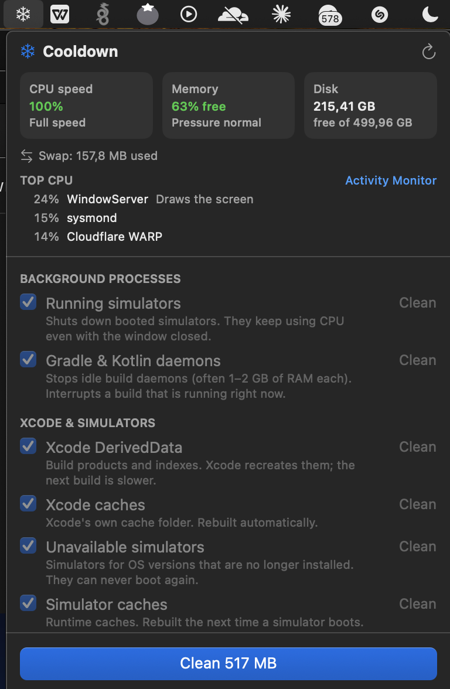

<p align="center">
  
</p>

<h1 align="center">Cooldown</h1>

<p align="center">
  A tiny macOS menu bar app that finds what is slowing your Mac down and cleans developer junk in one click.
</p>

<p align="center">
  <a href="https://github.com/Viltrumlik/cooldown/actions/workflows/ci.yml"></a>
  
  
  <a href="LICENSE"></a>
</p>

<p align="center">
  <a href="https://github.com/Viltrumlik/Cooldown/releases/latest"><b>⬇️ Download the latest release</b></a>
</p>

**Cooldown is a free, open-source Mac cleaner for developers.** It frees the space taken by Xcode DerivedData, iOS Simulators, Gradle, npm, Yarn, pip, CocoaPods and Homebrew caches. It stops simulators and build daemons you forgot about, and it tells you when your MacBook is being throttled by heat.

<p align="center">
  
</p>

---

## Why

My Intel MacBook Pro was lagging badly. `pmset -g therm` said `CPU_Speed_Limit = 52`: the CPU was running at half speed because it was too hot. The cause wasn't a heavy app. It was **two iOS Simulators I had closed hours earlier** that were still booted in the background, burning CPU through `SimMetalHost` and `backboardd`. On top of that, 38 GB of Xcode files and gigabytes of Gradle, npm and pub caches had piled up.

Cooldown puts all of that in one place: a snowflake in the menu bar. Click it to see what is wrong, then press **Clean**.

## Features

- **Live status**: CPU speed limit (heat throttling on Intel Macs, thermal state on Apple Silicon), memory pressure, swap, free disk space, and the processes eating the most CPU, with plain-English hints such as *SimMetalHost → iOS Simulator*.
- **One-click clean** of the usual developer leftovers, with the size of each item shown before you press anything.
- **Stops runaway background processes**: booted simulators, Gradle and Kotlin daemons.
- **Menu bar icon turns into a flame 🔥** when your Mac is being slowed down by heat.
- **Safe by default**: anything with a cost (re-download, slow rebuild, can't be undone) is opt-in and needs a second click to confirm.
- Native SwiftUI, no network access, no telemetry, no third-party dependencies.

## What it cleans

| Item | Default | After cleaning |
|---|:---:|---|
| Running simulators | ✅ | Shut down; boot them again from Xcode |
| Gradle & Kotlin daemons | ✅ | Stopped; the next build starts a fresh one |
| Xcode DerivedData | ✅ | Recreated; the next build is slower |
| Xcode caches | ✅ | Rebuilt automatically |
| Unavailable simulators | ✅ | Gone; they could never boot again anyway |
| Simulator caches | ✅ | Rebuilt on the next boot |
| npm / Yarn / Bun caches | ✅ | Packages are downloaded again when needed |
| pip cache | ✅ | Wheels are downloaded again when needed |
| Homebrew downloads | ✅ | Leftover installer files only |
| CocoaPods cache | ✅ | Pods are downloaded again on `pod install` |
| Device support files ⚠️ | — | Copied again when you reconnect a device |
| Xcode archives ⚠️ | — | You lose dSYMs of shipped builds |
| Gradle caches ⚠️ | — | Dependencies are downloaded again |
| Dart pub cache ⚠️ | — | Run `flutter pub get` again |
| Editor caches (VS Code, Cursor, …) ⚠️ | — | Quit the editors first |
| Other app caches ⚠️ | — | Apple's caches are always left alone |
| Trash ⚠️ | — | Cannot be undone |

Rows for tools you don't have are hidden.

## Install

1. Download `Cooldown-x.y.z.zip` from the [latest release](https://github.com/Viltrumlik/cooldown/releases/latest).
2. Unzip it and move **Cooldown.app** to **Applications**.
3. Open it. The app is signed ad hoc but not notarized by Apple, so the first launch is blocked. Allow it once with either:
   - **System Settings → Privacy & Security → Open Anyway**, or
   - Terminal: `xattr -dr com.apple.quarantine /Applications/Cooldown.app`

Optional: tick **Launch at login** in the popover.

Emptying the Trash or other app caches may need **Full Disk Access** (System Settings → Privacy & Security). Without it, those rows show a 🔒 and are skipped. Because builds are signed ad hoc, macOS may forget that permission after an update; grant it again if the 🔒 comes back.

## Build from source

Requires Xcode 15 or later, or the Command Line Tools, on macOS 13+.

```bash
git clone https://github.com/Viltrumlik/cooldown.git
cd cooldown
swift test                 # run the unit tests
./scripts/build-app.sh     # builds build/Cooldown.app for your Mac
open build/Cooldown.app
```

For a universal build (Apple Silicon + Intel, needs full Xcode), run `ARCHS="arm64 x86_64" ./scripts/build-app.sh`.

You can also run it straight from SwiftPM with `swift run Cooldown`. *Launch at login* only works from the `.app`.

## How it stays safe

Deleting files is the dangerous part, so every deletion goes through [`PathGuard`](Sources/CooldownCore/Safety/PathGuard.swift):

- A target can only empty a **root folder inside your home folder**. Symlinks are resolved first, so a `~/.npm` that points to `/` is refused.
- Roots such as `~`, `~/Documents`, `~/Desktop`, `~/Library` and `~/Library/Application Support` are **refused** outright.
- Only **direct children** of the root are removed. The root itself stays.
- Symlinks inside a cache are removed as links; **the files they point to are never touched**.
- Processes are only stopped if they belong to you, and they get a polite `SIGTERM`.
- Cooldown never asks for your password and never runs anything with `sudo`.

All of this is covered by unit tests in [`Tests/`](Tests/CooldownCoreTests).

## Architecture

```
Sources/
├── CooldownCore/            # Foundation only, no UI, unit-tested
│   ├── Model/               # CleanTarget protocol, ScanResult, CleanReport
│   ├── Safety/PathGuard     # what may be deleted
│   ├── Targets/             # DirectoryTarget, ProcessTarget, simulators, Catalog
│   ├── Monitor/             # SystemMonitor + parsers for pmset, sysctl, ps, simctl
│   └── Execution/           # Shell (timeouts, no pipe deadlocks), DiskUsage
└── Cooldown/                # SwiftUI MenuBarExtra app
    ├── AppModel             # scanning, cleaning, state
    └── Views/               # popover UI
```

Every cleanable thing implements one small protocol:

```swift
protocol CleanTarget: Sendable {
    var info: TargetInfo { get }          // title, detail, group, risk, default
    func scan() async -> ScanResult       // read-only
    func clean() async -> CleanOutcome
}
```

Adding a new cache folder is usually one entry in [`Catalog.swift`](Sources/CooldownCore/Targets/Catalog.swift). See [CONTRIBUTING.md](CONTRIBUTING.md).

## Roadmap

- [ ] Docker (`docker system prune`) and Android emulator snapshots
- [ ] Per-project `node_modules` / `build` folder finder
- [ ] Notarized builds and a Homebrew cask
- [ ] Localization (Uzbek, Russian)
- [ ] Optional scheduled clean

Ideas and pull requests are welcome.

## License

[MIT](LICENSE) © Alisher ([@Viltrumlik](https://github.com/Viltrumlik))
